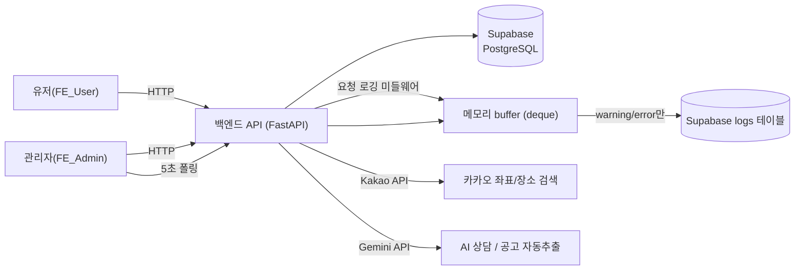

# 공공임대 및 분양 청약 통합 안내 서비스

공공임대·분양 청약 정보를 한곳에 모아 조회하고, 관심 있는 공고를 즐겨찾기로 관리하며, 주변 생활권 정보와 AI 상담까지 받을 수 있는 통합 안내 서비스입니다. 관리자는 청약정보를 등록·관리하고, **실시간 로그 대시보드**로 서비스 운영 상태를 모니터링합니다.

## 목차

1. [기획 배경과 문제 정의](#1-기획-배경과-문제-정의)
2. [타겟 사용자와 사용 시나리오](#2-타겟-사용자와-사용-시나리오)
3. [프로젝트 개요](#3-프로젝트-개요)
4. [통합 아키텍처](#4-통합-아키텍처)
5. [실시간 로그 모니터링 (이슈 #7)](#5-실시간-로그-모니터링-이슈-7)
6. [주요 기능 상세](#6-주요-기능-상세)
7. [팀원별 담당 기능](#7-팀원별-담당-기능)
8. [기술 스택](#8-기술-스택)
9. [필수 산출물](#9-필수-산출물)
10. [시연 순서](#10-시연-순서)
11. [로컬 실행 방법](#11-로컬-실행-방법)
12. [알려진 제한사항](#12-알려진-제한사항)

---

## 1. 기획 배경과 문제 정의

공공임대·분양 청약 정보는 LH, SH, 각 지자체, 민간 분양 사이트 등 **공급 주체마다 공고 게시 위치가 흩어져 있어**, 실제로 청약을 준비하는 사람이 "지금 내가 지원할 수 있는 공고가 뭐가 있는지"를 한눈에 파악하기 어렵습니다. 공고 하나하나도 PDF나 HWP 형태의 공문서로 게시되는 경우가 많아, 보증금·월세·모집 인원·신청 기간 같은 핵심 정보를 확인하려면 공고문을 직접 열어 읽어야 하는 진입장벽이 있습니다.

이 프로젝트는 이 문제를 두 방향에서 풀었습니다.

1. **유저 관점 — 정보 접근성**: 여러 곳에 흩어진 공고를 한곳에 모아 조건검색·정렬·즐겨찾기로 관리할 수 있게 하고, 공고 주변의 실제 생활 인프라(지하철·마트·병원)까지 지도로 보여줘서 "여기 살면 어떨지"에 대한 판단을 돕습니다. 청약 제도 자체가 생소한 사람을 위해 AI 상담·안내원 기능도 붙였습니다.
2. **운영 관점 — 관리 효율성**: 관리자가 공고를 수동으로 하나하나 입력하는 대신, PDF·HWPX 공고문을 업로드하면 AI가 항목을 자동으로 추출해 등록 폼을 채워주는 기능을 만들어 등록 작업의 반복 노동을 줄였습니다. 또한 서비스가 실제로 잘 돌아가고 있는지 관리자가 실시간으로 확인할 수 있도록 로그 모니터링 시스템을 구축했습니다(이 프로젝트가 속한 과제의 공식 요구사항이기도 합니다).

> 단순히 화면을 만드는 게 아니라, **설계 문서와 실제 구현이 일치하고 배포된 환경에서 핵심 기능이 실제로 동작하는 것**을 목표로 삼았습니다. 아래 모든 기능은 로컬 개발 환경뿐 아니라 Render·Streamlit Cloud에 배포된 실제 환경에서 동작을 확인했습니다.

## 2. 타겟 사용자와 사용 시나리오

### 타겟 사용자

| 구분                    | 설명                                                                                                         |
| ----------------------- | ------------------------------------------------------------------------------------------------------------ |
| **일반 유저**           | 공공임대·분양 청약을 알아보는 개인. 특히 처음 청약을 준비해서 용어와 절차가 낯선 사용자를 우선 고려했습니다. |
| **관리자(운영 담당자)** | 청약 공고를 등록·관리하고, 유저 반응(즐겨찾기 현황)과 서비스 상태(로그)를 모니터링하는 역할.                 |

### 사용 시나리오

**시나리오 1 — 신혼부부의 청약 탐색**
> 신혼집을 알아보는 사용자가 회원가입 후 "청약정보 조회"에서 지역과 보증금 상한을 조건으로 검색합니다. 마음에 드는 공고 2~3건을 즐겨찾기에 담고, "주변생활권 분석"에서 각 공고 주변 지하철역까지의 도보 거리와 근처 마트·병원을 비교합니다. 청약 자격 요건이 헷갈려 "AI 상담"에 질문을 남기고, 답변을 참고해 최종 지원 여부를 결정합니다.

**시나리오 2 — 관리자의 신규 공고 등록**
> 새 공고가 나오면 관리자는 공고 PDF를 "청약정보 등록(자동)" 화면에 올립니다. Gemini가 PDF를 읽어 공고명·보증금·월세·모집 인원·신청 기간을 추출하고, 문서 안의 사진도 각 세대 유형에 자동으로 매칭합니다. 관리자는 추출된 값 중 이상하거나 비어 있는 항목만 확인·수정한 뒤 등록을 확정합니다. 마감된 공고나 중복 등록된 공고는 목록에서 여러 건을 선택해 한 번에 삭제합니다.

**시나리오 3 — 운영 중 장애 대응**
> 서비스 운영 중 특정 API에서 오류가 늘어나면, 관리자는 "로그 대시보드"에서 5초마다 갱신되는 화면으로 warning/error 발생을 즉시 확인합니다. level 필터를 error로 좁혀 어떤 화면(API 경로)에서 문제가 발생했는지 확인하고, "로그 이력 조회"에서 과거 발생 이력을 기간별로 다시 조회해 재발 여부를 점검합니다.

**시나리오 4 — 빈 데이터·오류 상황**
> 즐겨찾기한 공고가 없는 신규 유저는 "즐겨찾기한 청약정보가 없습니다" 안내를 보고 자연스럽게 청약정보 조회로 유도됩니다. 백엔드 연결이 끊기면 화면은 "백엔드 서버에 연결할 수 없습니다. 서버 실행 상태를 확인해 주세요"라는 명확한 오류 메시지를 보여주며, 로그인 세션이 만료되면 "로그인 정보가 만료되었습니다. 다시 로그인해 주세요"로 재로그인을 안내합니다.

## 3. 프로젝트 개요

관리자는 청약 공고를 등록·관리하고, 유저는 공고를 조회·검색하며 마음에 드는 공고를 즐겨찾기에 담아 관리할 수 있는 서비스입니다. 여기에 더해 이번 과제의 핵심 요구사항인 **실시간 로그 대시보드**를 얹어, 실제 서비스 요청을 실시간으로 수집·조회·시각화합니다.

- 백엔드 API 서버(`BE`) 하나에, 관리자용 화면(`FE_Admin`)과 유저용 화면(`FE_User`) 두 개의 Streamlit 프런트엔드가 붙는 구조입니다.
- 데이터는 Supabase(PostgreSQL)에 저장하며, 유저 회원가입·로그인은 Supabase Auth(이메일 방식)에 맡깁니다.
- 관리자 계정은 자체 회원가입 없이 중앙에서 미리 발급합니다.

### 폴더 구조

```text
aio-01-p1-team1/
├─ BE/          # FastAPI 백엔드 (Supabase 연동, 실시간 로그 미들웨어)
├─ FE_Admin/    # 관리자용 Streamlit 화면
├─ FE_User/     # 유저용 Streamlit 화면
└─ docs/        # API 설계 문서 / 화면 설계서 / DB 설계서 / README (팀원별 작성분)
    ├─ plan/
    ├─ wireframe/
    ├─ database_design/
    ├─ API_notification/
    └─ readme/
```

## 4. 통합 아키텍처



- **UI → 백엔드 → DB** 흐름: 모든 화면(FE_Admin/FE_User)은 백엔드 API만 호출하고, DB에 직접 접근하지 않습니다(단, 회원가입/로그인은 Supabase Auth에 직접 요청).
- **로그 흐름**: 모든 요청이 미들웨어를 거치며 상태코드·응답시간 기준으로 `info`/`warning`/`error`로 자동 분류됩니다. `info`는 메모리에만, `warning`/`error`는 Supabase `logs` 테이블에도 저장되어 서버 재시작 후에도 이력 조회가 가능합니다.
- **배포 구성**: 백엔드는 Render(단일 인스턴스, `--workers` 미사용), 프런트엔드 2종은 Streamlit Community Cloud에 각각 배포. 환경변수와 API 키는 각 플랫폼의 Secrets/Environment Variables로 관리하며 코드에 하드코딩하지 않습니다.

## 5. 실시간 로그 모니터링 (이슈 #7)

이번 과제의 공식 프로젝트 주제인 실시간 로그 대시보드를 다음과 같이 구현했습니다.

- **수집**: `@app.middleware("http")`가 모든 요청을 가로채 처리 시간과 상태코드를 기록 (`5xx`→`error`, `4xx`→`warning`, 3초 이상 걸린 `2xx`→`warning`, 나머지→`info`)
- **저장**: `collections.deque(maxlen=200)` 메모리 buffer + `warning`/`error`는 Supabase `logs` 테이블에 이중 저장
- **조회/시각화**: FE_Admin의 "로그 대시보드"가 5초마다 자동 갱신되며 레벨별 필터·막대그래프 제공, "로그 이력 조회"는 DB에 저장된 이력을 기간·레벨별로 조회
- **왜 이렇게 설계했는가**: Render 무료 티어는 디스크 영구 저장이 보장되지 않아 파일 기반 로깅 대신 메모리+DB 이중 저장을 선택했고, Streamlit의 실행 모델에 맞춰 WebSocket push 대신 5초 폴링(`st.fragment`)을 선택했습니다. 실시간(push) vs 준실시간(polling), 파일 vs 메모리 저장을 놓고 무료 인프라 제약을 기준으로 비교한 설계 근거와, 이후 발견한 동시성 버그·성능 최적화 과정은 `docs/readme/kiwi248.md` 및 팀 블로그 기록에 상세히 남겼습니다.

## 6. 주요 기능 상세

### 6-1. 유저 페이지 (FE_User)

| 화면              | 기능                                                                                                                                        | 비고                                       |
| ----------------- | ------------------------------------------------------------------------------------------------------------------------------------------- | ------------------------------------------ |
| 홈                | 서비스 소개, 로그인 여부에 따른 안내 문구 분기                                                                                              |                                            |
| 로그인 / 회원가입 | Supabase Auth 기반 이메일 로그인, 약관 동의 2단계 + 관심분야(최대 4개) 등 추가정보 입력                                                     | 새로고침해도 세션 유지(Session Storage)    |
| 청약정보 조회     | 지역·최대보증금·최대월세 조건검색, **9가지 정렬 기준**(등록 최신순/신청 마감 빠른순/면적·모집인원·보증금·월세 순), D-DAY 표시, 페이지네이션 | 마감된 공고는 목록 뒤로 밀리고 흐리게 표시 |
| 즐겨찾기          | 즐겨찾기 등록/삭제, 즐겨찾기한 공고를 지도에 마커로 표시(즐겨찾기 지도)                                                                     | My Page에서 분리된 전용 화면               |
| 주변생활권 분석   | 공고명/주소로 검색 → Kakao 좌표 변환 → 반경 내 지하철역·마트·병원 조회 및 지도 표시, 공고 상세 팝업                                         | 도보 소요시간 함께 표시                    |
| My Page           | 닉네임·휴대폰·생년월일·관심분야·비밀번호 수정                                                                                               |                                            |
| AI 상담           | Gemini 기반 자유 질의응답, 대화 이력(Redis, 최근 10개 문맥) 유지, 상담 요약 저장/조회/삭제                                                  |                                            |
| AI 안내원         | "사이트 이용 방법"과 "간단한 청약 용어·계산"만 답하는 제한된 범위의 안내 챗봇, 범위 밖 질문은 명시적으로 거절                               | 세션 내에서만 유지(비영구)                 |

### 6-2. 관리자 페이지 (FE_Admin)

| 화면                    | 기능                                                                                                                                                                              | 비고                                                                                   |
| ----------------------- | --------------------------------------------------------------------------------------------------------------------------------------------------------------------------------- | -------------------------------------------------------------------------------------- |
| 로그인                  | 관리자 계정(중앙 발급) 로그인, Session Storage 기반 로그인 유지                                                                                                                   | `/admin/*` API 자체엔 토큰 인증이 없어 화면단 로그인 상태로만 접근 제어(제한사항 참고) |
| 청약정보 등록(수동)     | 공고 항목 직접 입력, 사진 최대 20장(장당 5MB) 업로드, 등록 후 입력값 유지(비슷한 공고 연속 등록 편의)                                                                             |                                                                                        |
| **청약정보 등록(자동)** | PDF/HWPX 공고문을 업로드하면 Gemini가 제목·주택명·면적·모집인원·보증금·월세·신청기간·상세설명을 추출, 문서 안 사진을 세대 유형별로 자동 매칭, 관리자가 항목별로 검수 후 확정 등록 | 아래 6-3에서 상세 설명                                                                 |
| 청약정보 조회/삭제      | 조건검색, 개별 수정/삭제, **여러 건 체크 후 한 번에 삭제(대량삭제)**                                                                                                              |                                                                                        |
| 즐겨찾기 순위           | 유저들이 즐겨찾기한 청약정보를 많이 찜한 순으로 조회                                                                                                                              |                                                                                        |
| 즐겨찾기 상세           | 어떤 유저가 어떤 공고를 즐겨찾기했는지 조회, 공고 ID로 필터                                                                                                                       |                                                                                        |
| **로그 대시보드**       | 실시간 요청 로그를 5초마다 자동 갱신, level 필터, 레벨별 막대그래프                                                                                                               | 5절 참고                                                                               |
| **로그 이력 조회**      | Supabase에 저장된 warning/error 이력을 기간·건수 단위(10/50/200건)로 조회                                                                                                         |                                                                                        |

### 6-3. AI 기반 공고 자동등록 — 동작 원리

관리자가 반복적으로 겪는 "공고 PDF를 보면서 필드를 하나하나 옮겨 적는" 수작업을 줄이기 위해 만든 기능으로, 다음 파이프라인으로 동작합니다.

1. **문서 텍스트 추출**: PDF는 Gemini가 직접 읽을 수 있어 그대로 전달하고, HWPX는 Gemini가 이해하지 못하므로 `document_text.py`가 zip 구조인 HWPX에서 본문 텍스트를 먼저 추출합니다.
2. **항목 추출(Gemini)**: 추출된 텍스트(또는 PDF 원본)를 Gemini에 보내 공고별로 제목·주택명·면적·모집인원·보증금·월세·신청기간·상세설명 등을 구조화된 형식으로 받습니다.
3. **검증(사람이 아닌 값 신뢰 금지)**: `listing_extract.py`가 모델이 반환한 값을 그대로 믿지 않고, 숫자·날짜로 해석 가능한지, 필수 항목이 비어 있지 않은지 다시 확인합니다. 문제가 있는 항목은 화면에서 관리자가 직접 입력하도록 안내합니다.
4. **사진 매칭**: `document_images.py`가 문서에서 이미지를 추출하고, `image_matching.py`가 사진을 세대 유형(한 세대 = 한 공고)에 자동으로 매칭합니다.
5. **확정 등록**: 추출값을 바로 저장하지 않고, 관리자가 화면에서 확인·수정한 값만 기존 "청약정보 등록" API로 전송합니다.

## 7. 팀원별 담당 기능

`develop`/`main` 브랜치의 커밋 이력을 기준으로 각 팀원이 실제로 구현한 영역입니다.

| 팀원              | 담당 영역                                               | 주요 구현 내용                                                                                                                                                                                                                                |
| ----------------- | ------------------------------------------------------- | --------------------------------------------------------------------------------------------------------------------------------------------------------------------------------------------------------------------------------------------- |
| **jasnok**        | 청약정보 조회/관리 전반                                 | 조건검색, 9가지 정렬 기준, 페이지네이션, 다중 이미지 업로드, D-DAY·마감순 정렬, 관리자 대량삭제, 등록 폼 UX(입력값 유지·초기화)                                                                                                               |
| **youngmin**      | 주변생활권 분석                                         | Kakao 주소 좌표 변환, 지하철 분석, 생활 시설(마트·병원) 통합 조회, 공고 상세 팝업, 지도 시설 아이콘                                                                                                                                           |
| **kiwi248**(본인) | 실시간 로그 모니터링(이슈 #7), 백엔드 성능 최적화, 배포 | 요청 로깅 미들웨어 설계, 시뮬레이터→실제 로깅 전환, 임계값 실측 산정, Supabase client 싱글턴/스레드-로컬 동시성 버그 수정(2754ms→1170ms, 동시요청 0/20→20/20), Render/Streamlit Cloud 배포, AI 챗봇 라우터·페이지 연결, 전체 페이지 UI 디자인 |
| **hyunport**      | AI 상담 챗봇                                            | Redis 기반 대화 이력 저장, Gemini 연동, 상담 요약 저장/조회, 인증 라우터(`chat_router`)                                                                                                                                                       |
| **glory-mint**    | 즐겨찾기 기능                                           | 즐겨찾기를 My Page에서 별도 페이지로 분리, 즐겨찾기 지도(Kakao 좌표 변환 연동)                                                                                                                                                                |

> 위 5명 외에 AI 기반 공고 자동등록(6-3절, PDF/HWPX 추출·이미지 매칭)과 AI 안내원 기능도 팀 내에서 추가로 구현되었습니다. 담당자별 상세 기획 의도는 `docs/plan/`, 화면 설계는 `docs/wireframe/`에서 각자 작성분을 확인할 수 있습니다.

## 8. 기술 스택

| 구분                | 기술                                                       |
| ------------------- | ---------------------------------------------------------- |
| 백엔드              | Python, FastAPI, Pydantic, Uvicorn                         |
| 프런트엔드          | Streamlit, httpx                                           |
| 데이터베이스 / 인증 | Supabase (PostgreSQL, Supabase Auth)                       |
| AI                  | Google Gemini (`google-genai`)                             |
| 캐시/세션           | Upstash Redis (AI 상담 대화 이력)                          |
| 지도/위치           | Kakao 지도 API, pydeck                                     |
| 배포                | Render (BE), Streamlit Community Cloud (FE_Admin, FE_User) |

## 9. 필수 산출물

| 산출물              | 위치                                                                               |
| ------------------- | ---------------------------------------------------------------------------------- |
| API 설계 문서       | [`docs/API_notification/`](docs/API_notification/)                                 |
| 화면 설계서         | [`docs/wireframe/`](docs/wireframe/)                                               |
| 데이터베이스 설계서 | [`docs/database_design/`](docs/database_design/), 스키마 원본 [`BE/sql/`](BE/sql/) |
| 프로젝트 기획서     | [`docs/plan/`](docs/plan/)                                                         |
| 팀원별 README       | [`docs/readme/`](docs/readme/)                                                     |

각 폴더는 팀원별(`jasnok`, `youngmin`, `kiwi248`, `hyunport`, `glory-mint`) 파일로 구성되어 있으며, 통합 문서는 발표 전까지 별도로 정리합니다.

### 참고 — 핵심 API 엔드포인트

| 그룹            | 예시 엔드포인트                                                                                                             |
| --------------- | --------------------------------------------------------------------------------------------------------------------------- |
| Listing         | `GET /listings/getall`, `GET /listings/search`, `GET /listings/get/{id}`                                                    |
| Admin           | `POST /admin/login`, `POST /admin/listings/create`, `PUT /admin/listings/update/{id}`, `DELETE /admin/listings/delete/{id}` |
| Favorite        | `POST /favorites/create`, `GET /favorites/mypage/{user_id}`, `DELETE /favorites/delete/{user_id}/{listing_id}`              |
| Location        | `GET /locations/geocode`, `GET /locations/nearby-subways`, `GET /locations/nearby-facilities`                               |
| Log             | `GET /logs`, `GET /logs/history`                                                                                            |
| Chat / AI Guide | `POST /chat/message`, `GET /chat/history`, `POST /ai-guide/message`                                                         |
| Profile         | `GET /profiles/{user_id}`, `PUT /profiles/{user_id}`                                                                        |

전체 명세와 요청/응답 스키마는 배포된 [Swagger 문서](https://aio-01-p1-team1.onrender.com/docs)에서 실시간으로 확인할 수 있습니다.

### 핵심 테이블

| 테이블           | 설명                                                                    |
| ---------------- | ----------------------------------------------------------------------- |
| `profiles`       | 유저 추가정보 (닉네임, 휴대폰, 생년월일, 관심분야) — `auth.users`와 1:1 |
| `admins`         | 관리자 계정 (비밀번호는 해시 저장)                                      |
| `listings`       | 청약 공고                                                               |
| `favorites`      | 유저-청약정보 즐겨찾기 (N:M), `(user_id, listing_id)` UNIQUE            |
| `listing_images` | 청약 공고 다중 이미지                                                   |
| `logs`           | warning/error 로그 이력 (`level`, `screen`, `message`, `latency_ms`)    |
| `chat_summaries` | AI 상담 요약 저장                                                       |

## 10. 시연 순서

1. FE_User에서 청약정보 조회 → 조건검색(지역/보증금/월세) 적용
2. 로그인 후 즐겨찾기 등록 → 즐겨찾기 지도에서 위치 확인
3. 주변생활권 분석에서 공고 주변 지하철·마트·병원 조회
4. AI 상담 페이지에서 질의응답
5. FE_Admin에서 청약정보 등록(수동/자동), 대량삭제 시연
6. **로그 대시보드**를 열어둔 채로 `BE/scripts/demo_traffic.py`를 실행해 warning 로그가 5초 안에 실시간 반영되는 것을 확인
7. 로그 이력 조회에서 warning/error 필터링 및 상세 확인

## 11. 로컬 실행 방법

### 사전 준비

- Python 3.12
- Supabase 프로젝트 (URL, Service Role Key, Anon Key)
- Kakao REST API 키, Gemini API 키, Upstash Redis URL (선택 기능용)

### 11-1. 데이터베이스 준비

Supabase SQL Editor에서 [`BE/sql/`](BE/sql/) 폴더의 SQL을 순서대로 실행해 테이블과 트리거를 생성합니다.

### 11-2. 백엔드(BE)

```bash
cd BE
python -m venv .venv
.venv\Scripts\activate
pip install -r requirements.txt
```

`BE/.env`에 `SUPABASE_URL`, `SUPABASE_SERVICE_ROLE_KEY` 등을 채운 뒤:

```bash
uvicorn app.main:app --reload
```

- API 문서: http://127.0.0.1:8000/docs

### 11-3. 관리자 프런트엔드(FE_Admin)

```bash
cd FE_Admin
python -m venv .venv
.venv\Scripts\activate
pip install -r requirements.txt
streamlit run app.py
```

### 11-4. 유저 프런트엔드(FE_User)

```bash
cd FE_User
python -m venv .venv
.venv\Scripts\activate
pip install -r requirements.txt
streamlit run app.py
```

`FE_User/.env`에 `SUPABASE_URL`, `SUPABASE_ANON_KEY`(anon/publishable key만 사용, Service Role Key는 절대 넣지 않음)를 채워야 합니다.

BE 서버(`http://127.0.0.1:8000`)가 먼저 실행되어 있어야 FE_Admin/FE_User가 정상 동작합니다.

## 12. 알려진 제한사항

- 관리자 API(`/admin/*`)는 로그인 화면과 별개로 실제 인증 토큰 검사가 없어, URL을 아는 경우 우회 호출이 가능합니다. 실서비스 전환 시 서명 토큰 기반 인증 도입이 필요합니다.
- Render 무료 티어는 콜드스타트가 있어, 장시간 미사용 후 첫 요청이 느릴 수 있습니다.
- 로그 buffer는 서버 프로세스 메모리에만 있어 재배포/재시작 시 `info` 레벨 로그는 사라집니다(`warning`/`error`는 DB에 남습니다).
