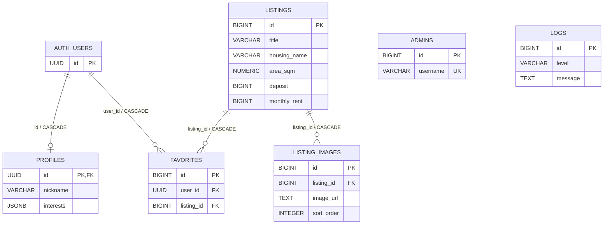

# 1팀 데이터베이스 설계서 - 발표용 요약

> 프로젝트: 공공임대 및 분양 청약 통합 안내 서비스  
> DBMS: Supabase PostgreSQL  
> 구성: Supabase Auth 1개 + `public` 테이블 6개

## 1. 한 문장 요약

사용자·공고·이미지·즐겨찾기를 관계형 구조로 분리하고, FK·UNIQUE·CHECK·인덱스를 적용해 **중복은 줄이고 데이터 무결성과 조회 성능은 높인 설계**이다.

## 2. 테이블 한눈에 보기

| 테이블 | 역할 | 핵심 관계 |
| --- | --- | --- |
| `auth.users` | Supabase 인증 사용자 | 프로필·즐겨찾기의 부모 |
| `profiles` | 닉네임·연락처·관심 분야 | 사용자와 1:0..1 |
| `admins` | 관리자 로그인 정보 | 독립 테이블 |
| `listings` | 청약 공고와 주택 유형 | 이미지·즐겨찾기의 부모 |
| `listing_images` | 공고별 다중 이미지 | 공고와 N:1 |
| `favorites` | 사용자와 공고의 연결 | 사용자·공고와 각각 N:1 |
| `logs` | warning/error 로그 | 독립 이력 테이블 |

`listings` 한 행은 **공고 안의 주택 1개 + 신청 유형(전용면적) 1개**를 의미한다.

## 3. 핵심 ERD



### 관계 설명

- 사용자 1명은 프로필을 최대 1개 가진다.
- 사용자 1명은 여러 공고를 즐겨찾기할 수 있다.
- 공고 1개는 여러 사용자의 즐겨찾기에 포함될 수 있다.
- 공고 1개는 여러 이미지를 가질 수 있다.
- 사용자나 공고가 삭제되면 관련 자식 데이터도 CASCADE로 삭제된다.

## 4. 설계 핵심 포인트

### 4.1 정규화

- 인증 정보는 `auth.users`, 추가 정보는 `profiles`로 분리했다.
- 여러 이미지는 `listing_images`로 분리했다.
- 사용자와 공고의 N:M 관계는 `favorites`로 해소했다.
- 운영 로그는 업무 데이터와 분리해 `logs`에 저장했다.

이를 통해 사용자 정보가 즐겨찾기마다 반복되거나 공고 정보가 이미지마다 반복되는 문제를 방지했다.

### 4.2 데이터 무결성

| 규칙 | 적용 방식 |
| --- | --- |
| 중복 즐겨찾기 방지 | `UNIQUE(user_id, listing_id)` |
| 이미지 순서 중복 방지 | `UNIQUE(listing_id, sort_order)` |
| 잘못된 금액 방지 | 보증금·월세 `CHECK >= 0` |
| 잘못된 기간 방지 | 신청 종료일 ≥ 시작일 |
| 잘못된 좌표 방지 | 위도 -90~90, 경도 -180~180 |
| 중요 로그만 저장 | level은 warning/error만 허용 |

API의 Pydantic 검증과 DB 제약조건을 함께 사용해 입력값을 이중으로 검증한다.

### 4.3 의도적 비정규화

| 항목 | 이유 | 향후 개선 |
| --- | --- | --- |
| `listings.image_url` | 목록 대표 이미지 빠른 조회 | 이미지 테이블로 단일화 |
| `profiles.interests` JSONB | 작은 관심 목록을 한 번에 조회 | 별도 관심 분야 테이블 도입 |
| 공고명·원문 URL 반복 | MVP 등록 구조 단순화 | 공고와 공급 유형 분리 |

핵심 관계는 3정규화를 따르되, MVP의 조회 편의와 기존 기능 호환을 위해 일부만 제한적으로 비정규화했다.

## 5. 인덱스

| 대상 | 인덱스 컬럼 | 목적 |
| --- | --- | --- |
| 공고 | `location` | 지역 검색 |
| 공고 | `deposit`, `monthly_rent` | 금액 범위 조회 |
| 공고 | `application_start_date DESC` | 신청 시작일 최신순 |
| 공고 | `application_end_date` | 마감 임박순 |
| 이미지 | `(listing_id, sort_order)` | 공고별 이미지 순서 조회 |
| 즐겨찾기 | `user_id`, `listing_id` | 마이페이지·공고별 집계 |
| 로그 | `time DESC`, `level` | 최근 로그·레벨 필터 |

## 6. 데이터 처리 흐름

### 회원가입

```text
Supabase Auth 회원가입
    → auth.users 생성
    → 트리거 실행
    → profiles 자동 생성
```

### 공고 이미지

```text
listings에 공고 저장
    → 생성된 listing id 확인
    → listing_images에 URL과 순서 저장
```

### 운영 로그

```text
info → 메모리에만 저장
warning/error → 메모리 + logs 테이블에 저장
```

## 7. 구현 일치 여부

| 설계 대상 | 실제 구현 | 결과 |
| --- | --- | --- |
| 사용자 인증 | Supabase `auth.users` | 일치 |
| 프로필 | `profiles`, `profile_service.py` | 일치 |
| 관리자 | `admins`, `admin_service.py` | 일치 |
| 청약 공고 | `listings`, `listing_service.py` | 일치 |
| 공고 이미지 | `listing_images`, `listing_service.py` | 일치 |
| 즐겨찾기 | `favorites`, `favorite_service.py` | 일치 |
| 운영 로그 | `logs`, `log_service.py` | 일치 |

## 8. 발표 대본

> 저희 팀은 Supabase PostgreSQL을 사용했고, 인증 테이블을 포함해 총 7개 테이블로 구성했습니다. 사용자 인증은 Supabase Auth에 맡기고 닉네임과 관심 분야 같은 추가 정보만 profiles로 분리했습니다. 청약 공고는 listings에 저장하고, 한 공고에 여러 이미지를 연결하기 위해 listing_images를 1:N 구조로 설계했습니다. 사용자의 즐겨찾기는 사용자와 공고 사이의 연결 테이블로 구성하고 UNIQUE 제약으로 중복 저장을 방지했습니다. 또한 FK에 ON DELETE CASCADE를 적용해 사용자나 공고가 삭제된 뒤 고아 데이터가 남지 않도록 했습니다. 지역, 금액, 신청 기간과 로그처럼 조회가 많은 컬럼에는 인덱스를 적용했습니다. 전체적으로 3정규화를 기준으로 설계했고, 대표 이미지와 관심 분야만 MVP 조회 편의를 위해 제한적으로 비정규화했습니다.

## 9. 예상 질문

- **왜 `profiles`를 분리했나요?**  
  인증 정보와 서비스용 사용자 정보를 분리해 책임과 보안을 명확히 하기 위해서다.

- **왜 `listing_images`가 필요한가요?**  
  한 공고에 여러 이미지를 저장하고 노출 순서를 독립적으로 관리하기 위해서다.

- **중복 즐겨찾기는 어떻게 막나요?**  
  `UNIQUE(user_id, listing_id)`로 DB에서 차단한다.

- **공고가 삭제되면 이미지는 어떻게 되나요?**  
  `ON DELETE CASCADE`로 관련 이미지 메타데이터도 함께 삭제된다.

- **왜 모든 로그를 DB에 저장하지 않나요?**  
  저장량을 줄이면서 장애 분석에 필요한 중요 이력을 남기기 위해 warning/error만 영속화한다.

- **왜 일부 데이터를 중복 저장했나요?**  
  MVP의 조회 속도와 기존 코드 호환을 위한 선택이며, 확장 시 정규화할 방향도 정의했다.
